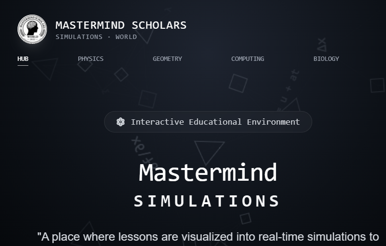
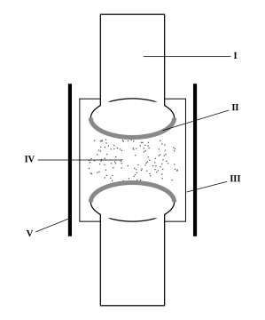
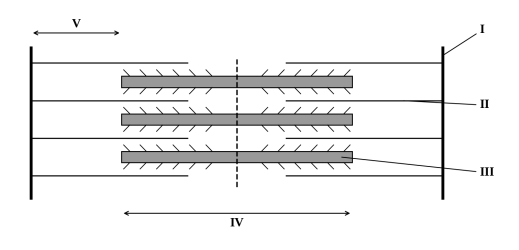

# Mastermind Simulations

<p align="center">
  
</p>



An offline-ready set of interactive learning labs for physics, mathematics, computing, and biology.

<p>
  
  
</p>

## Learning labs

- **Projectile Motion:** change the launch speed, angle, height, and gravity; explore the predicted path and measurements.
- **Circle Segments:** learn circle parts, use the segment-area lab, and practise with interactive questions.
- **Data & Logic:** operate stacks and queues, trace linear and binary searches, and explore logic gates.
- **Skeletal System:** explore the 3D skeleton, bone labels, study cards, question banks, past papers, and the exam.

## Run the site

### Offline use on Windows

1. Download `Mastermind-Simulations-Offline.zip` from the site or the repository and extract the whole archive.
2. Install Python 3 if it is not already available.
3. Double-click `START-OFFLINE-SITE.bat` and keep its console open while using the site.
4. The site opens at <http://127.0.0.1:8000>.

Keep the extracted folders together. The 3D model and lesson materials use relative paths, so opening `index.html` directly as a `file://` page will prevent some browser features from working.

### Local development

Requirements: Node.js 18 or newer and Python 3.

```sh
npm ci
npm run build:css
npm run serve
```

Open <http://127.0.0.1:8000>. The development dependency is pinned in `package-lock.json`. The site itself uses local JavaScript libraries and assets; the `build:css` command rebuilds the Tailwind stylesheet after changing its input or the HTML classes.

To refresh the downloadable site archive after editing files:

```sh
npm run package:offline
```

The archive generator excludes Git metadata and installed development dependencies. The generated archive is `Mastermind-Simulations-Offline.zip`.

## Contributing and task tracking

Read [CONTRIBUTING.md](CONTRIBUTING.md) before opening a pull request. Use the GitHub issue forms for bug reports and feature requests. The board setup guide is in [.github/PROJECT_BOARD.md](.github/PROJECT_BOARD.md); once a maintainer creates the live board, accepted issues can be added from the [repository Projects page](https://github.com/gosafoosei/Mastermind/projects).

## Licensing

The MIT license in [LICENSE](LICENSE) applies to the project's original source code and documentation. It does not relicense the school emblem, third-party libraries, anatomical model, diagrams, scanned pages, or course PDFs. Their separate terms and attributions are listed in [THIRD-PARTY-NOTICES.txt](THIRD-PARTY-NOTICES.txt); retain those notices when redistributing the offline package.

## Repository map

- `index.html` — the complete multi-lab application.
- `tailwind.input.css`, `tailwind.config.js`, `tailwind.css` — stylesheet source, build configuration, and generated CSS.
- `vendor/`, `webfonts/` — locally served third-party JavaScript, CSS, and fonts.
- `assets/`, `files/` — the emblem, model, diagrams, scans, and downloadable learning materials.
- `scripts/build_offline_zip.py` — rebuilds the offline distribution archive.
